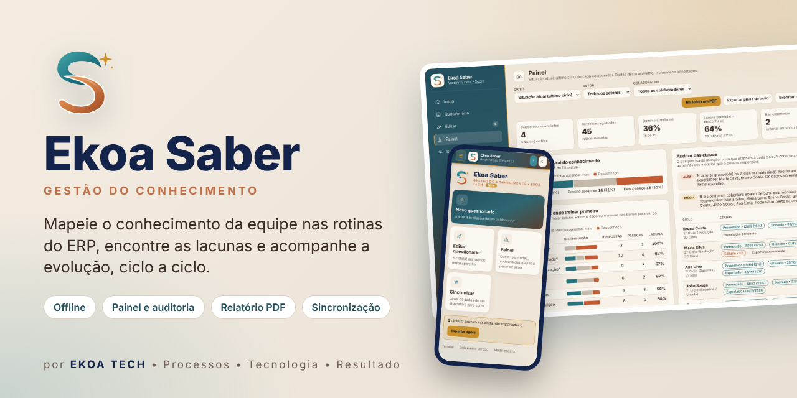
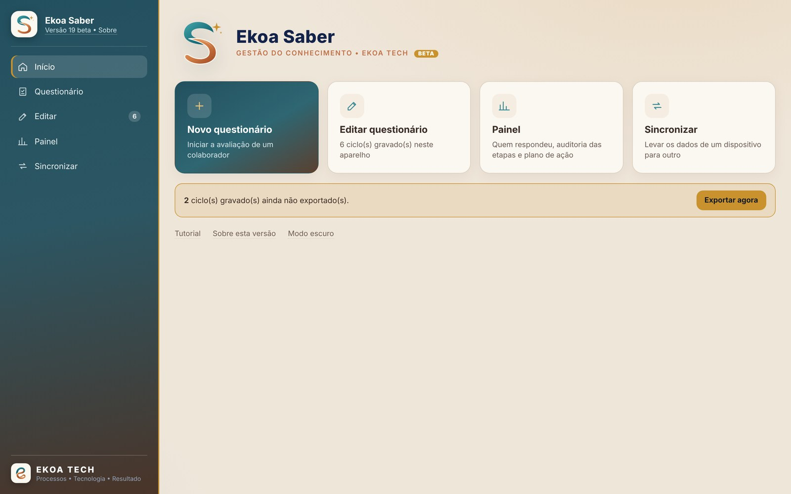
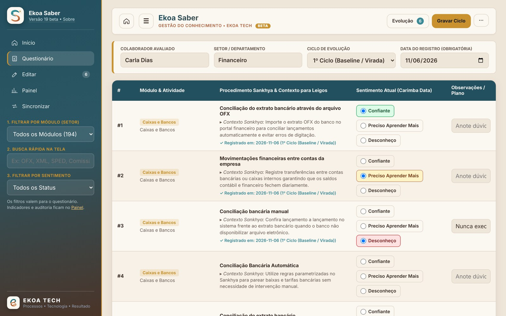
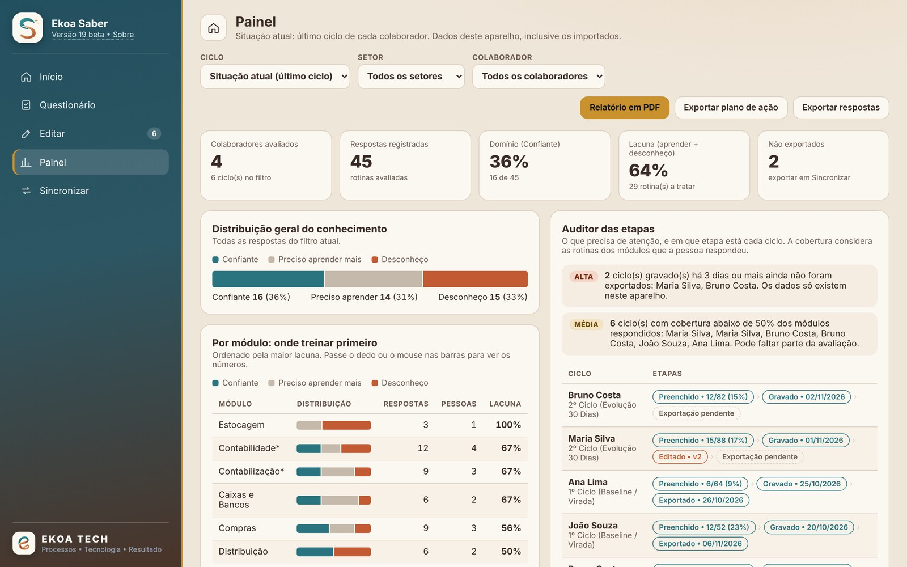
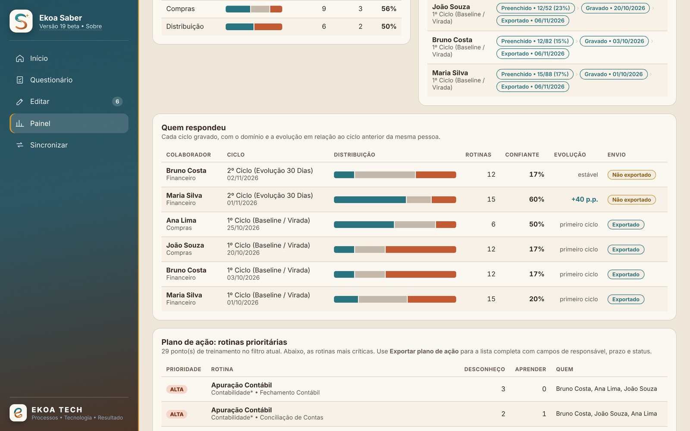
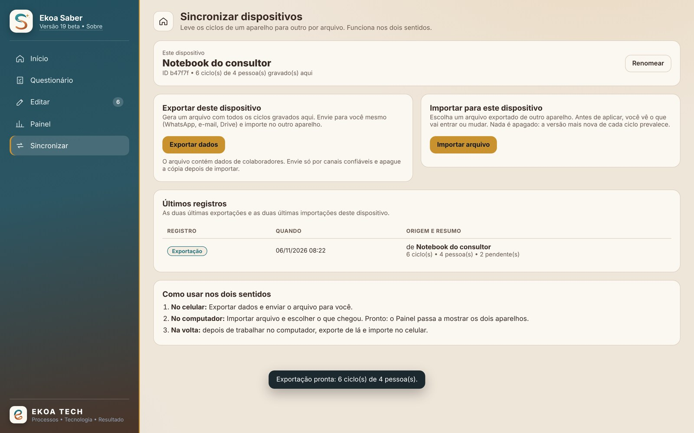
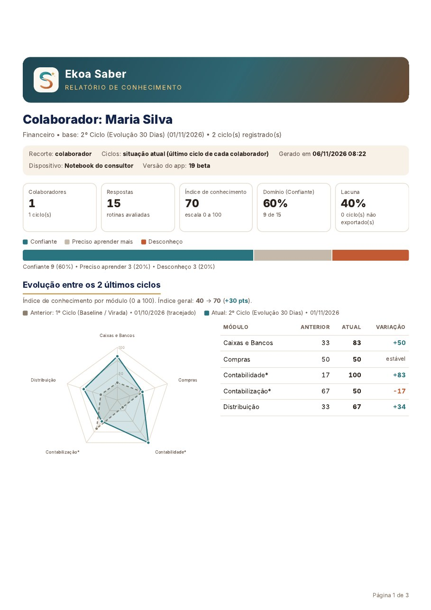
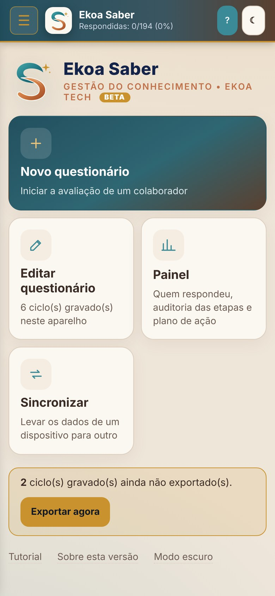
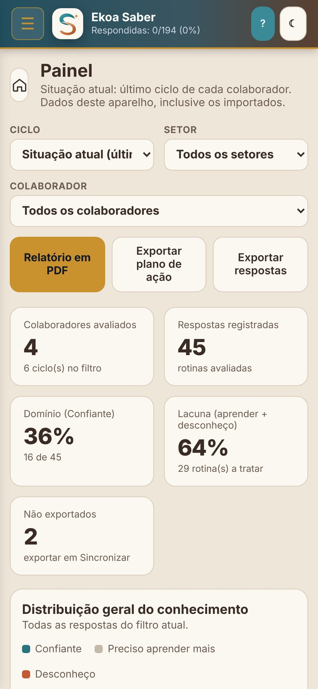
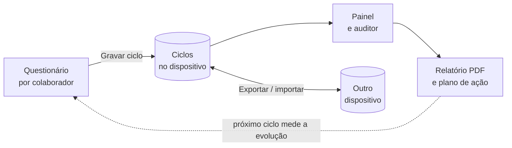

<div align="center">



# Ekoa Saber

**Mapeie o conhecimento da equipe nas rotinas do ERP, encontre as lacunas e acompanhe a evolução, ciclo a ciclo.**

[](CHANGELOG.md)
[](#instalação)
[](#princípios-de-engenharia)
[](#instalação)

[**Abrir o app**](https://ekoacorp-tech.github.io/ekoasaber/) · [Novidades](CHANGELOG.md) · [Arquitetura](docs/arquitetura.md) · [Sincronização](docs/sincronizacao.md)

</div>

---

## Por que o Ekoa Saber existe

Implantar um ERP não termina no "go live". O que sustenta o sistema no dia a dia é **o conhecimento das pessoas que o operam**, e esse conhecimento costuma ser invisível até que um erro apareça no fechamento do mês.

O Ekoa Saber torna esse conhecimento **mensurável**. Cada colaborador avalia o próprio domínio sobre as rotinas do sistema. A partir daí, o app mostra onde estão as lacunas, quem precisa de apoio, o que treinar primeiro e se o treinamento funcionou no ciclo seguinte.

> **Dados → Informação → Indicador → Análise → Decisão**

## O que ele faz

<table>
<tr>
<td width="50%"></td>
<td width="50%"></td>
</tr>
<tr>
<td><b>Tela inicial.</b> Novo questionário, edição, Painel e sincronização a um toque. O app avisa o que ainda não foi exportado.</td>
<td><b>Questionário.</b> 194 rotinas organizadas por módulo. Para cada uma: <i>Confiante</i>, <i>Preciso aprender mais</i> ou <i>Desconheço</i>, com observação.</td>
</tr>
<tr>
<td></td>
<td></td>
</tr>
<tr>
<td><b>Painel e auditor.</b> Índice de conhecimento, domínio e lacuna por módulo, com o auditor das etapas: a trilha de cada ciclo e alertas do que precisa de atenção.</td>
<td><b>Quem respondeu e prioridades.</b> Cada pessoa com a evolução entre ciclos, e as rotinas mais críticas para o plano de ação.</td>
</tr>
<tr>
<td></td>
<td align="center"></td>
</tr>
<tr>
<td><b>Sincronização entre dispositivos.</b> Do celular para o computador e de volta, com prévia, integridade verificada e "desfazer".</td>
<td><b>Relatório em PDF.</b> Por setor, colaborador ou geral, com <b>radar de evolução</b> entre os dois últimos ciclos e a origem rastreável de cada dado.</td>
</tr>
</table>

<div align="center">
&nbsp;&nbsp;

<br><sub>A mesma base de código no celular: instalável e utilizável sem internet.</sub>
</div>

## Como funciona



1. **Avaliar:** o colaborador responde, com ou sem internet. O ciclo fica gravado no dispositivo.
2. **Consolidar:** os dispositivos trocam ciclos por arquivo de sincronização. A versão mais nova de cada ciclo prevalece, e nada é apagado sem passar pela lixeira.
3. **Analisar:** o Painel calcula o **índice de conhecimento** (0 a 100), aponta lacunas por módulo e destaca a evolução de cada pessoa.
4. **Agir e medir:** relatório em PDF e plano de ação exportável. O ciclo seguinte mostra se a ação surtiu efeito.

## Princípios de engenharia

| Princípio | Como se traduz no app |
|---|---|
| **Offline-first** | Service Worker com cache do app; os dados ficam em IndexedDB, no próprio dispositivo. |
| **Os dados do usuário são intocáveis** | Atualizações nunca mexem nos dados; cópia de segurança antes de importar ou atualizar; exclusão sempre passa pela lixeira. |
| **Rastreabilidade** | Cada ciclo carrega ID único, versão, dispositivo de origem e de edição, e as datas de criação, edição e exportação. |
| **Sincronização sem servidor** | Pacote JSON com verificação de integridade SHA-256, mesclagem por versão, registro de exclusões e detecção de conflitos. [Detalhes](docs/sincronizacao.md) |
| **Entrada não confiável** | Todo arquivo importado é validado, normalizado e exibido de forma segura. |
| **Atualização assistida** | O app consulta `version.json`, mostra as novidades e atualiza com um toque, sem perder dados. |
| **Sem dependências externas** | HTML, CSS e JavaScript puros; o relatório em PDF usa a impressão nativa do sistema. |

## Instalação

Abra **https://ekoacorp-tech.github.io/ekoasaber/** e instale:

- **Android ou computador (Chrome/Edge):** botão **Instalar app** na tela inicial do Ekoa Saber, ou menu do navegador → *Instalar app*.
- **iPhone (Safari):** Compartilhar → **Adicionar à Tela de Início**.

Depois de instalado, o app funciona sem internet. Novas versões são avisadas dentro do próprio app.

## Estrutura do projeto

```text
index.html      app completo: interface, regras, catálogo de rotinas e relatório
sw.js           Service Worker: cache offline e estratégia de atualização
manifest.json   instalação como app (nome, ícones, cores)
version.json    versão publicada e notas, lidas pelo aviso de atualização
icons/          ícones do app
docs/           arquitetura, sincronização e publicação
```

## Roadmap

- [x] PWA offline, instalável em Android, iPhone e computador
- [x] Painel com auditor das etapas e plano de ação exportável
- [x] Sincronização entre dispositivos com integridade e lixeira
- [x] Relatório em PDF com radar de evolução
- [ ] **Plano de ação PDCA:** triagem das lacunas, priorização GUT, Ishikawa, 5W2H e verificação automática de eficácia
- [ ] Resposta "Não se aplica ao meu setor" no questionário
- [ ] Integração com o ERP por um serviço intermediário seguro (usuários, permissões e gravação centralizada)
- [ ] Publicação nas lojas (App Store e Google Play)

## Sobre a Ekoa

A **Ekoa** aproxima **processos, tecnologia, informação e pessoas** para gerar resultado. O Ekoa Saber nasceu da prática de consultoria em implantação de ERP: medir o conhecimento é o primeiro passo para que um sistema seja de fato usado, e não apenas instalado.

<div align="center">

**Processos que fazem sentido. Tecnologia que sustenta. Informação que orienta. Consultoria que transforma.**

</div>

---

<sub>© 2026 Ekoa Tech. Todos os direitos reservados. O código está visível para avaliação e estudo; o uso, a cópia ou a redistribuição dependem de autorização da Ekoa.<br>
Sankhya é marca de seus respectivos titulares. O Ekoa Saber é um produto independente da Ekoa e não tem vínculo com a Sankhya; o nome aparece apenas para descrever as rotinas avaliadas.<br>
As telas desta página usam dados fictícios.</sub>
