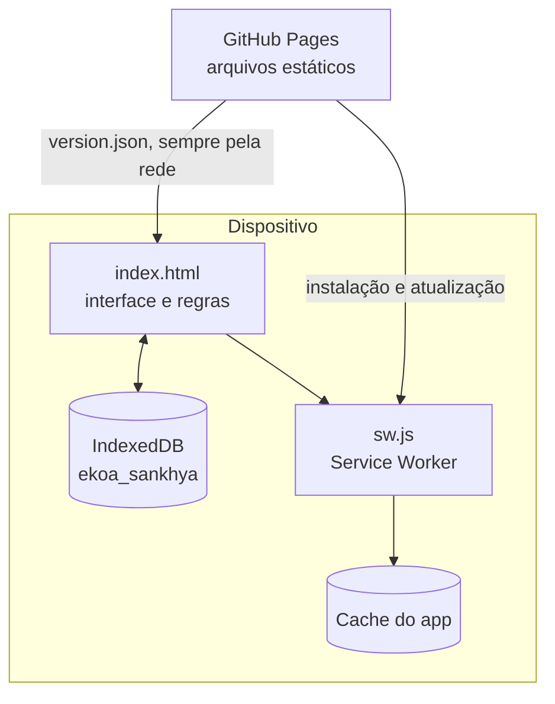

# Arquitetura

O Ekoa Saber é um **PWA (Progressive Web App)** escrito em HTML, CSS e JavaScript puros, sem dependências externas nem servidor de aplicação. O GitHub Pages entrega os arquivos estáticos; todo o resto acontece no dispositivo.



## Arquivos

| Arquivo | Responsabilidade |
|---|---|
| `index.html` | Interface, regras de negócio, catálogo das rotinas avaliadas (`DATA`), Painel, sincronização e relatório em PDF (`#printArea` + CSS de impressão). A logo é um SVG embutido. |
| `sw.js` | Cache dos arquivos do app para uso offline. A constante `V` identifica a versão do cache. |
| `manifest.json` | Torna o app instalável (nome, ícones, cores, modo `standalone`). |
| `version.json` | Versão publicada e notas de cada versão; base do aviso de atualização. |

## Dados no dispositivo (IndexedDB)

| Chave | Conteúdo |
|---|---|
| `draft` | Respostas em andamento, ciclos gravados (`savedCycles`), edição em andamento, `lixeira` e `excluidos` |
| `syncMeta` | Dispositivo (id e nome), últimas exportações e importações, arquivos já importados, última versão vista |
| `backupPreImport` | Cópia de segurança feita antes de cada importação (permite "desfazer") |
| `backupPreUpdate` | Cópia de segurança feita antes de cada atualização |

### Modelo de um ciclo

```text
{ id (UUID), versao, status ("pendente" | "enviado" = Exportado), reenvio,
  nome, setor, ciclo, data, totalRespondido, confiante, aprender, desconheco,
  origem {id, nome}, editadoNo {id, nome}, criadoEm, editadoEm, enviadoEm,
  items: [{ id da rotina, modulo, atividade, procedimento, sentimento, obs }] }
```

O **índice de conhecimento** (0 a 100) é a média das respostas: Confiante = 100, Preciso aprender mais = 50 e Desconheço = 0.

## Cache e atualização

- **Estratégia:** o app responde primeiro pelo cache (para funcionar offline) e atualiza o cache em segundo plano quando há rede.
- **Instalação do Service Worker** com `cache: 'reload'`, para não gravar no cache cópias antigas vindas do cache HTTP do navegador.
- **`version.json` nunca passa pelo cache:** o app o consulta ao abrir, ao voltar para o app e pelo botão "Verificar atualizações".
- **Atualizar agora:** grava o rascunho, faz uma cópia de segurança, baixa os arquivos novos sem cache, substitui o cache e recarrega. Na primeira abertura da nova versão, aparece "o que mudou".

## Identificadores estáveis

Alguns identificadores internos ainda carregam o nome antigo do projeto e **não devem ser alterados**: o banco `ekoa_sankhya`, o cache `ekoa-sankhya-vN` e o campo `app: "sankhya-sapiens"` do arquivo de sincronização. Alterá-los apagaria dados dos usuários ou quebraria a compatibilidade entre versões.

## Segurança

- Arquivos importados são **dados não confiáveis**: cada campo é validado e limitado, IDs fora do padrão são descartados e todo texto é exibido escapado.
- Nenhuma credencial fica no app. Uma futura integração com o ERP passará por um serviço intermediário (HTTPS), nunca direto do navegador.
- As avaliações são **dados pessoais (LGPD)**: os arquivos de sincronização e os relatórios devem circular apenas por canais confiáveis.
