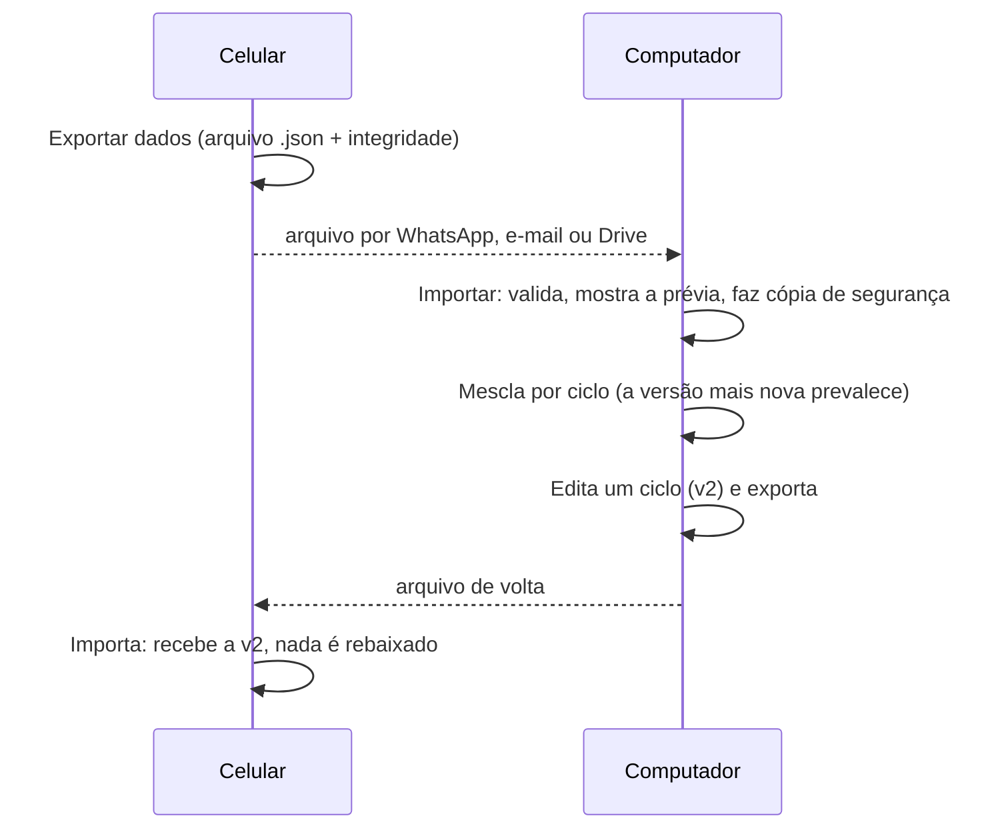

# Sincronização entre dispositivos

Sem servidor, os dispositivos trocam dados por **arquivo**: um exporta, o outro importa. O processo funciona nos dois sentidos e foi desenhado para **nunca perder nem duplicar** dados.



## Formato do arquivo (formato 2)

```text
{ app: "sankhya-sapiens", formato: 2, versaoApp, exportadoEm, exportId,
  dispositivo: { id, nome },
  resumo: { ciclos, pessoas, pendentes, excluidos },
  ciclos: [ ... ],
  excluidos: [ { id, em, no: { id, nome } } ],
  integridade: SHA-256 de { ciclos, excluidos } }
```

O formato 1 (versões 16 a 18) continua importável, sem verificação de integridade e sem registro de exclusões.

## Regras de mesclagem (por ID do ciclo)

| Situação | Resultado |
|---|---|
| O ciclo não existe aqui | Entra |
| A versão do arquivo é maior | Substitui a daqui |
| A versão daqui é maior | Mantém a daqui (um arquivo antigo nunca rebaixa) |
| Mesma versão e mesmo conteúdo | Igual; se lá estava "Exportado", marca aqui também |
| Mesma versão e conteúdo diferente | **Conflito:** vale a edição mais recente, com aviso na prévia |

## Exclusões

Excluir gera um **registro de exclusão** (ID, data e dispositivo), que viaja no arquivo. Sem ele, um ciclo excluído "ressuscitaria" ao importar um arquivo antigo.

| Situação | Resultado |
|---|---|
| Excluído lá e não editado aqui depois | Vai para a **lixeira** aqui (nunca é apagado direto) |
| Excluído lá, mas editado aqui **depois** | **Mantido**, com aviso |
| Excluído aqui e o arquivo traz o ciclo | Continua excluído, salvo se foi editado lá **depois** da exclusão (aí volta, com aviso) |
| Restaurar da lixeira | Conta como edição e vence exclusões mais antigas |

## Proteções contra erro do usuário

- **Prévia** antes de aplicar: o que entra, o que muda, o que fica e o que vai para a lixeira.
- **Desfazer última importação**, com base na cópia de segurança feita antes de aplicar.
- **Arquivo errado:** PDF, CSV ou planilha escolhidos por engano recebem uma mensagem explicando qual arquivo usar.
- **Integridade:** arquivo alterado ou corrompido é bloqueado.
- **Arquivo repetido** ou **mais antigo** que outro já importado do mesmo dispositivo: aviso na prévia.
- **Edição em andamento:** a importação fica bloqueada até gravar ou cancelar; a exportação avisa que alterações não gravadas não entram.
- **Arquivo do mesmo dispositivo:** aviso de que normalmente não há nada a importar.

## Registro

A tela Sincronizar mostra as **duas últimas exportações e as duas últimas importações**, com dispositivo, data e resumo, além de quantos ciclos ainda não foram exportados.
